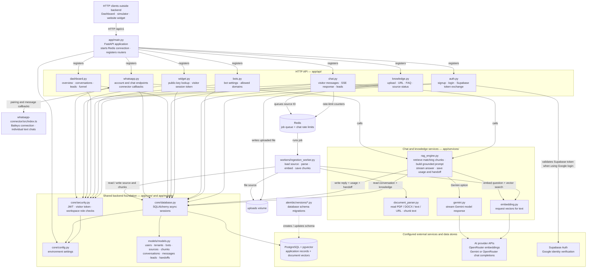

# Backend architecture, mapped to files

This map covers `backend/` and the services it talks to. The boxes name the files that own each responsibility. The dashboard and website widget are outside the map; they call the HTTP API shown at the top.

## What happens in each area

### 1. Application entry point

[`app/main.py`](../backend/app/main.py) creates the FastAPI application, opens a Redis connection when the app starts, applies CORS middleware, and registers the API routers. This is the API's wiring point: it connects incoming URLs to the files in `app/api/`.

### 2. HTTP route files

- [`app/api/auth.py`](../backend/app/api/auth.py) handles password-based signup/login and Google login's Supabase-token exchange. Signup creates a user, workspace (`Tenant`), membership, and starter bot.
- [`app/api/bots.py`](../backend/app/api/bots.py) reads and updates bots and their approved website domains.
- [`app/api/widget.py`](../backend/app/api/widget.py) looks up an active bot by its public key, checks the requesting origin against approved domains, and issues a visitor-session token.
- [`app/api/chat.py`](../backend/app/api/chat.py) validates that visitor token, rate-limits chat requests using Redis, saves the visitor message, starts answer generation, and streams events to the caller as Server-Sent Events (SSE). It also accepts lead details.
- [`app/api/knowledge.py`](../backend/app/api/knowledge.py) accepts files, URLs, and FAQs. It creates a knowledge-source record, then enqueues background processing. Its list/delete endpoints let the dashboard manage sources.
- [`app/api/dashboard.py`](../backend/app/api/dashboard.py) reads stored records to return overview metrics, conversations/messages, leads, funnel stages, and unanswered questions.
- [`app/api/whatsapp.py`](../backend/app/api/whatsapp.py) manages the workspace's WhatsApp account, selected assistant, pause setting, and per-chat toggles. Authenticated callbacks from the local Baileys connector discover chats and generate replies through the shared AI and knowledge service.

### 3. Shared security, configuration, and database access

- [`app/core/security.py`](../backend/app/core/security.py) creates and validates JWTs. Dashboard calls use a user token and workspace membership/role checks. Public chat uses a separate visitor token containing the bot, tenant, session, and (when present) origin.
- [`app/core/database.py`](../backend/app/core/database.py) builds the async SQLAlchemy engine/session used by the routes and worker.
- [`app/core/config.py`](../backend/app/core/config.py) reads settings such as database URL, Redis URL, token secret, AI provider/model, and embedding dimensions from environment variables.
- [`app/models/models.py`](../backend/app/models/models.py) defines the data tables and their relationships. A workspace owns bots; bots own knowledge, conversations, and leads; conversations own messages. Document chunks store their vectors for similarity search.

### 4. Knowledge ingestion: one background job

The knowledge API saves the uploaded file under the uploads directory (a shared volume in Docker) or saves a URL/FAQ in the database. It queues the source ID in Redis. [`app/workers/ingestion_worker.py`](../backend/app/workers/ingestion_worker.py) picks up the job, marks the source as processing, and calls [`app/services/document_parser.py`](../backend/app/services/document_parser.py) to extract text and split it into overlapping chunks. For URL sources it checks that the destination is not a private/internal address. The worker calls [`app/services/embedding.py`](../backend/app/services/embedding.py) for a vector per chunk, then stores the chunks and marks the source ready. If processing fails, it marks the source failed with an error message.

This work happens outside the request so a file upload can return quickly while parsing and embedding continue in the worker process.

### 5. Chat: one streamed request

The widget-session route gives the browser a visitor token. Later, `chat.py` uses that token to identify the bot and visitor session. It saves the visitor's message, then calls [`app/services/rag_engine.py`](../backend/app/services/rag_engine.py):

1. `rag_engine.py` calls `embedding.py` to turn the question into a vector.
2. It searches `DocumentChunk` rows belonging to that bot and tenant, ranking them by vector similarity in pgvector (or in Python for SQLite).
3. It combines sufficiently relevant chunks with the bot's instructions and recent conversation history.
4. It streams generated text from the configured chat model. Gemini calls go through [`app/services/gemini.py`](../backend/app/services/gemini.py); the OpenRouter path is made from `rag_engine.py` itself.
5. It emits answer chunks and a final event with citations/escalation links, then stores the reply, usage event, and any handoff record in the database.

### 6. Persistence and schema

In the Docker setup, PostgreSQL with the pgvector extension stores the application records and knowledge vectors. Redis stores queued ingestion jobs and temporary chat rate-limit counters. Alembic scripts in `alembic/versions/` create and evolve the SQL schema; `compose.yaml` runs migrations before the backend starts.

For native development, `config.py` has a SQLite default, while Docker Compose explicitly configures PostgreSQL. The vector search code supports both, with a slower in-Python similarity calculation for SQLite.

## A quick way to read the backend

Follow a request from the outside inward: `main.py` → the matching `api/*.py` route → `core/security.py` and `core/database.py` → a service in `services/` if needed → `models/models.py` / PostgreSQL. For uploaded knowledge, follow the separate path: `api/knowledge.py` → Redis → `workers/ingestion_worker.py` → parser and embedding service → database.
